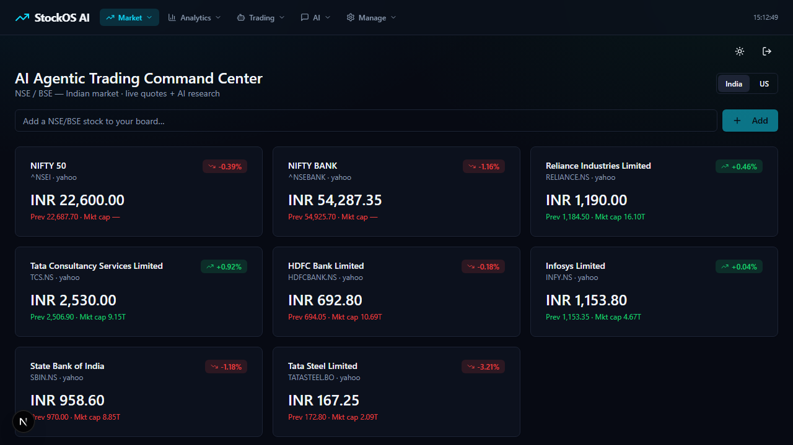
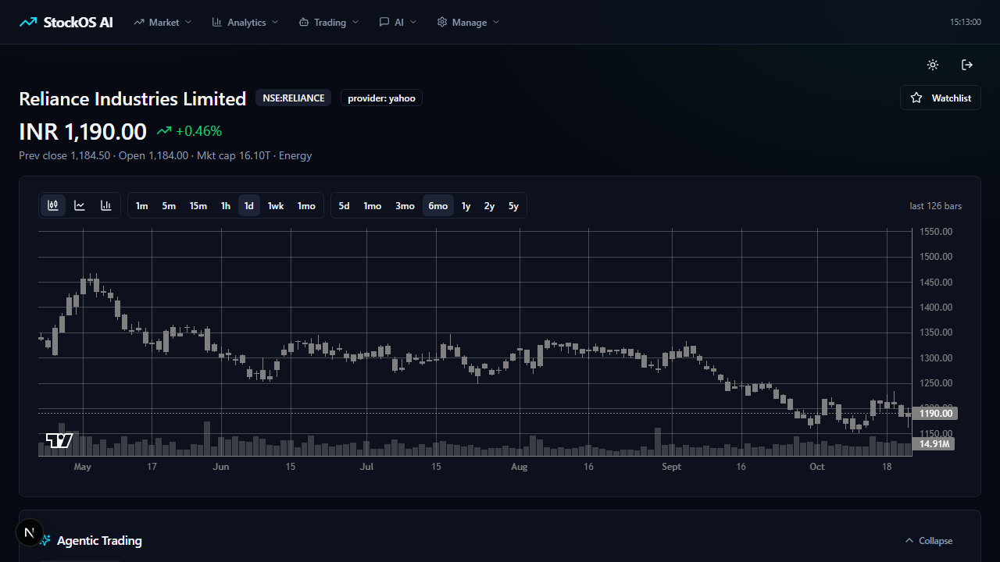
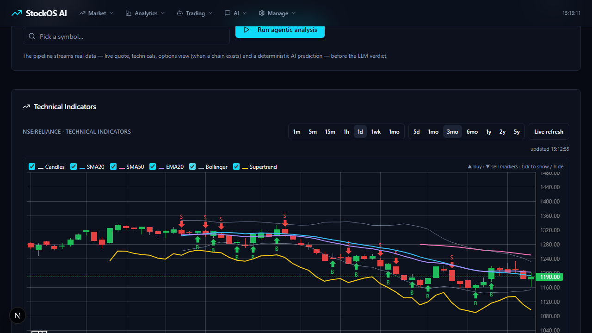
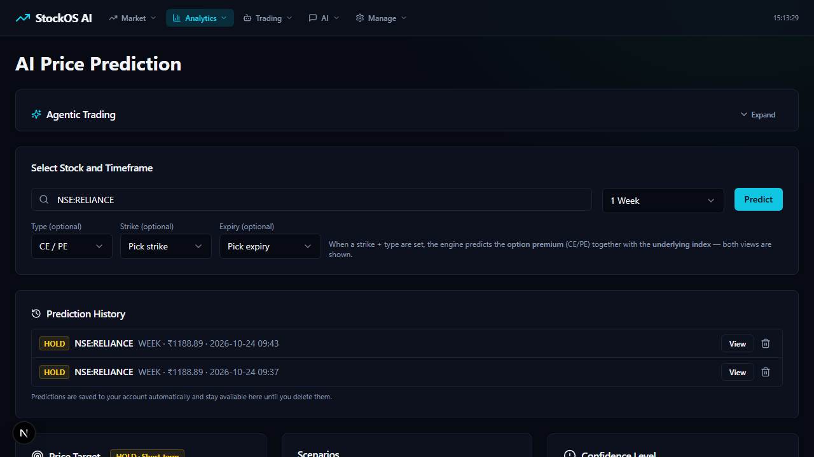
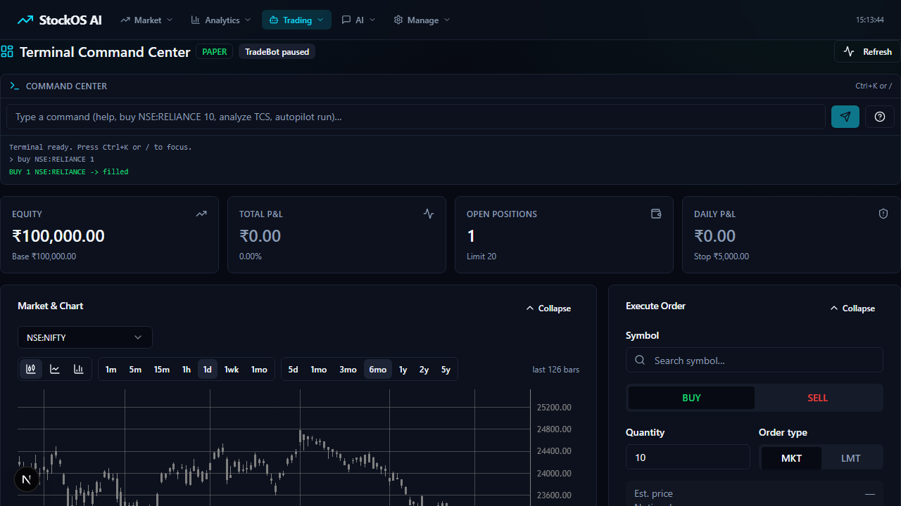

# StockOS AI


StockOS AI is a local-first stock market research and paper-trading platform.
It combines market data, technical analysis, options analytics, AI-assisted
research, risk controls, and a multi-agent autopilot that runs entirely in
paper mode by default.

## New in this release

Pages (all verified at `frontend/app/<route>/page.tsx`):

- `/flow` — Flow builder: graph list, validate (422 on unknown node types), dry-run, import/export, schedule toggle.
- `/strategies` — Strategy host: script list + editor, run/stop, encrypted env vars (write-only), log viewer.
- `/streaming` — Live quotes: REST status/latest/market plus WS `/quotes` and `/market`.
- `/agent-extras` — Voice STT (`/voice/transcribe`), attachments, web-search, skills.
- `/operations` — Ops dashboards backed by `/monitoring/health`, `/monitoring/latency`, `/monitoring/traffic`.
- `/calendar` — Market holidays/timings/status admin (`/calendar/*`).
- `/pnl` — PnL summary + equity curve (`/pnl/summary`, `/pnl/equity`).
- `/historify` — Historical-data ingest/query/jobs/catalog (`/historify/*`, 30+ routes).
- `/action-center` — Approval queue: list, approve/reject/execute (`/action-center/*`).
- `/ai-tools` — LLM registry, MCP clients (`/mcp/clients/*`), chart markup, broker plugins.
- `/options-analytics` — OI profile/change, IV smile, vol surface, GEX, straddle + margin endpoints (`/options/analytics/*`, `/options/margin/*`).

Backend endpoints (routers in `backend/app/api/routers/`, registered in
`routers/__init__.py`; app mounts them under `api_prefix="/api"`, frontend
`api` client strips that prefix):

| Area | Method + path |
|---|---|
| Flow (`flow.py`, prefix `/flow`) | `GET /flow/graphs`, `POST /flow/graphs`, `GET/PATCH/DELETE /flow/graphs/{id}`, `POST /flow/validate`, `POST /flow/run`, `POST /flow/import` (POST-only), `GET /flow/export/{id}` |
| Strategy host (`strategy_host.py`, prefix `/strategy-host`) | `GET/POST /strategy-host/scripts`, `GET/PATCH/DELETE /strategy-host/scripts/{id}`, `POST /strategy-host/scripts/{id}/run`, `POST /strategy-host/scripts/{id}/stop`, `GET /strategy-host/scripts/{id}/logs`, `GET/PUT /strategy-host/scripts/{id}/env` |
| Streaming (`streaming.py`, prefix `/streaming`) | `GET /streaming/status`, `GET /streaming/quotes/latest`, `GET /streaming/market`, `WS /streaming/quotes`, `WS /streaming/market` |
| Agent extras (`agent_extras.py`, no prefix) | `POST /voice/transcribe`, `POST /agent/attachments`, `GET /agent/attachments`, `DELETE /agent/attachments/{att_id}`, `GET /agent/websearch`, `GET /agent/skills` |

Notes: concurrent strategy `run` while active returns 409 single-flight;
`/flow/import` has no GET variant; strategy env GET returns names only.

## Demo

- Video: [demo.mp4](demo.mp4)
- Source clip: [clips/](clips/)
- Screenshots: [docs/shots/](docs/shots/)

## Features

- Market data and charts for Indian and US symbols
- Technical indicators and signal markers
- AI research and prediction views
- Options chain analysis and strategy helpers
- Paper trading with risk limits and kill switch
- AI agentic analysis and autopilot missions
- Learning memory for agent insights

## Requirements

- Python 3.12+
- Node.js 18+
- `uv` (recommended) or `pip`
- Optional local LLM runtime such as Ollama

## Quick start

Backend:

```bash
cd backend
uv sync
uv run uvicorn app.main:app --reload --port 8000
```

Frontend:

```bash
cd frontend
npm install
npm run dev
```

Open:

- Frontend: http://localhost:3000
- Backend API: http://localhost:8000
- API docs: http://localhost:8000/docs

## Optional environment

Copy `backend/.env.example` to `backend/.env` and configure providers, keys, and
database settings. Copy `frontend/.env.local.example` if present, or create
`frontend/.env.local`:

```env
NEXT_PUBLIC_API_URL=http://localhost:8000
```

## Safety notes

- Default execution mode is `PAPER`. No live orders are sent unless
  `execution_mode=LIVE_ENABLED` and broker credentials are configured.
- Risk limits are enforced by the backend risk engine.
- Never commit `.env`, API keys, database files, or local runtime data.

## UI overview

StockOS AI includes a unified Terminal Command Center plus market, analytics,
trading, and AI views. Representative screens:







## Third-party services and licenses

This project uses third-party market-data and LLM providers. Their APIs and
licenses remain with their respective owners. See each provider's terms before
enabling live or paid usage.

- Yahoo Finance (yfinance) - market data
- TradingView scanner endpoints - Indian option chains
- NSE public endpoints - Indian options (may be access-limited)
- Ollama / LM Studio / llama.cpp - local LLM runtimes
- OpenAI-compatible providers - optional cloud/local LLM endpoints

## License

This project is for educational and research purposes. Review all third-party
licenses before redistribution or commercial use.
