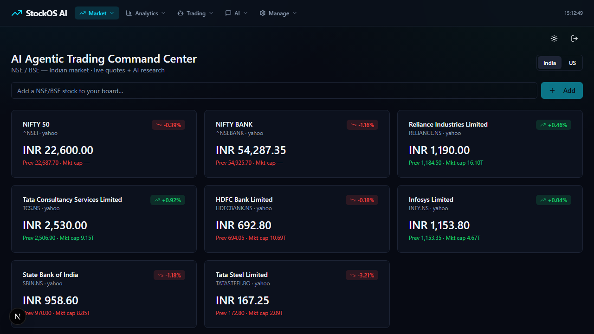
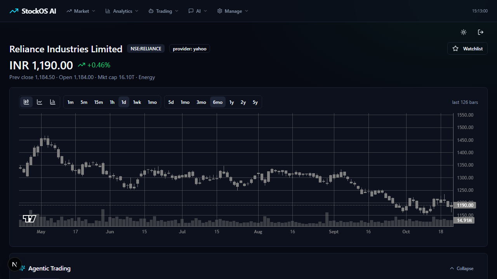
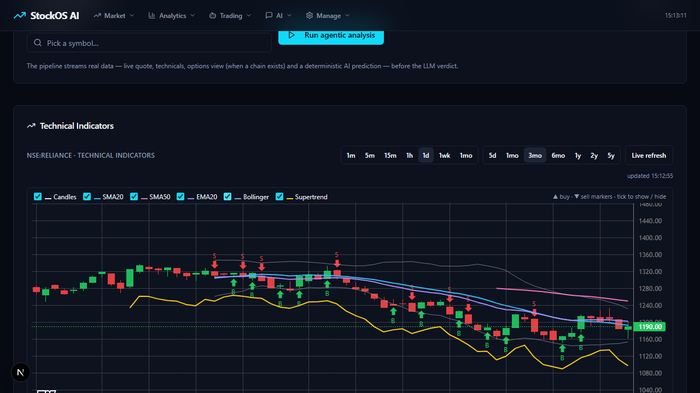
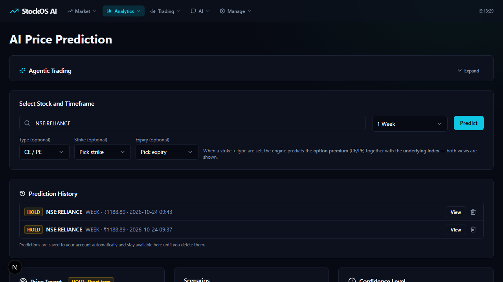
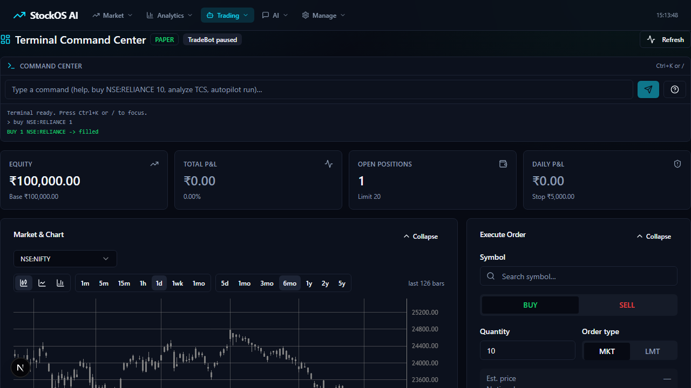

# StockOS AI Demo Media

This branch adds screenshots and usage notes for the StockOS AI intro demo.

## Demo files

- Video: `demo.mp4` (local, generated from `clips/page@*.webm`)
- GIF: `demo.gif`
- Screenshots: `docs/shots/*.png`
- Recorder: `demo.mjs`

## YouTube chapters

| Time | Chapter |
|------|---------|
| 0:00 | Hook - What is StockOS AI? |
| 0:05 | Live Market Dashboard |
| 0:15 | Technical Indicators |
| 0:25 | AI Prediction |
| 0:45 | Paper Trading Terminal |
| 1:00 | Outro and GitHub link |

## Screenshots

### Hook

### Live Market Dashboard

### Technical Indicators

### AI Prediction

### Paper Trading Terminal

### Outro

## Usage

1. Start the backend: `cd backend && uv run uvicorn app.main:app --port 8000`
2. Start the frontend: `cd frontend && npm run dev`
3. Open `http://localhost:3000`
4. Sign in or create a local account.
5. Explore Market, Analytics, Trading, and AI menus.

## Third-party services

- Yahoo Finance via `yfinance`
- TradingView scanner endpoints
- NSE public endpoints
- Local or cloud LLM providers configured in `backend/.env`
